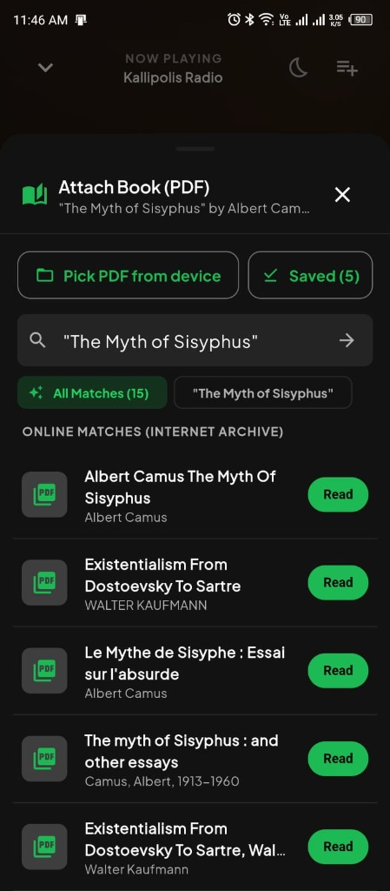
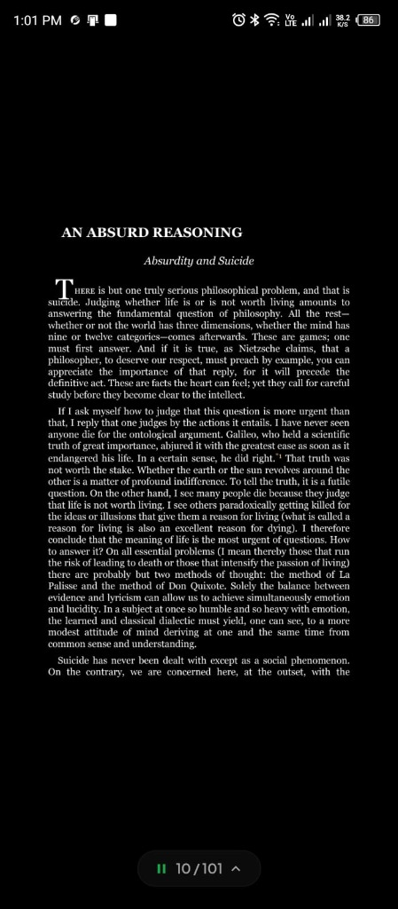
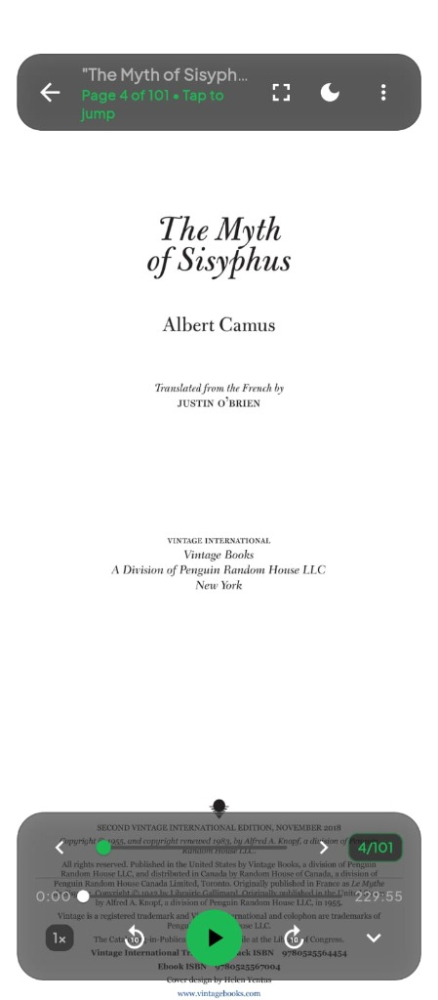
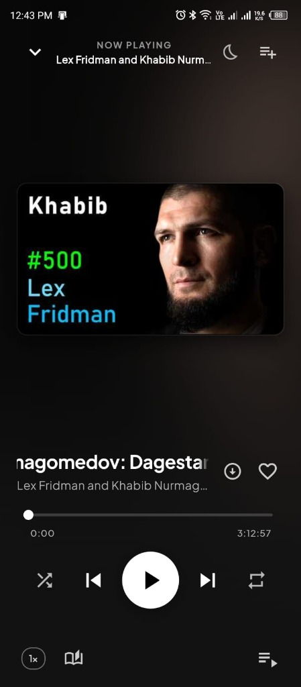
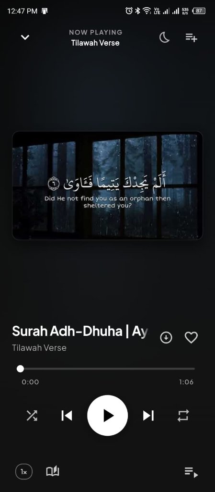
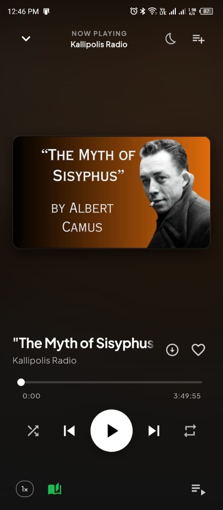
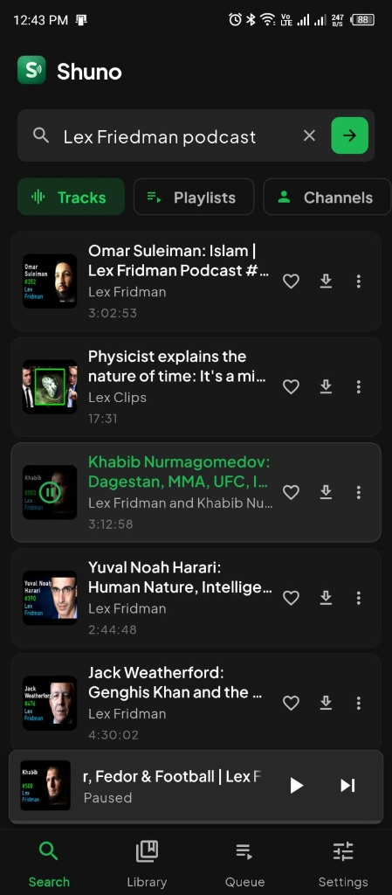
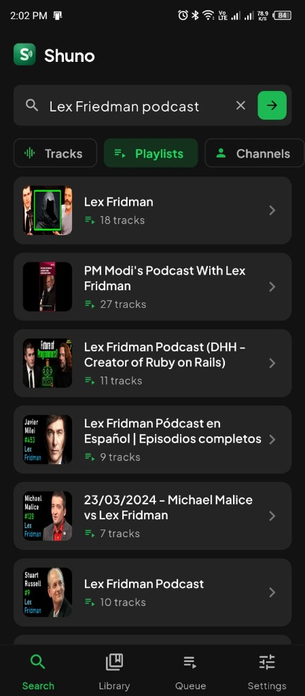
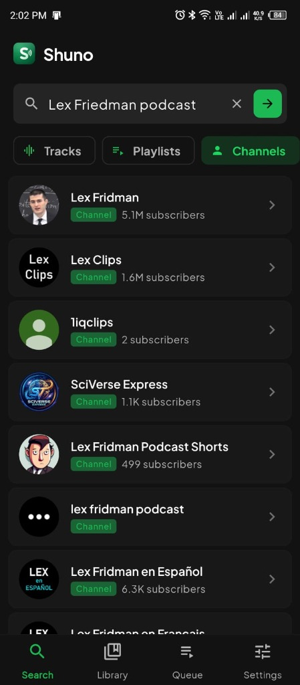

<p align="center">
  
</p>

<h1 align="center">Shuno</h1>

<p align="center">
  A modern, <strong>100% ad-free</strong>, local-first audio player built with Flutter, designed specifically for an immersive <strong>Audiobook + PDF Reading</strong> experience, podcast listening, and long-form spoken-word audio.
</p>

<p align="center">
  <a href="#-download-apk">Download APK</a> •
  <a href="#-immersive-audiobook--pdf-reader">Audiobook & PDF Reader</a> •
  <a href="#-audio--spoken-word-playback">Now Playing & Controls</a> •
  <a href="#-search--catalog-discovery">Search & Discovery</a> •
  <a href="#-spotify-grade-queue--library">Queue & Library</a> •
  <a href="#architecture-overview">Architecture</a> •
  <a href="#getting-started">Getting Started</a>
</p>

---

## 📥 Download APK

Get the latest Android release from the [**GitHub Releases**](https://github.com/MahirSalahin/shuno/releases/latest) page:

<p align="center">
  <a href="https://github.com/MahirSalahin/shuno/releases/latest">
    
  </a>
</p>

| Package | Architecture | Size | Recommended For |
|---|---|---|---|
| [**`shuno-v0.1.0-arm64-v8a.apk`**](https://github.com/MahirSalahin/shuno/releases/latest) | `arm64-v8a` | **27.0 MB** | **Recommended** (99% of modern Android smartphones) |
| [**`shuno-v0.1.0.apk`**](https://github.com/MahirSalahin/shuno/releases/latest) | Universal | **71.7 MB** | Universal build compatible with all device architectures |
| [**`shuno-v0.1.0-armeabi-v7a.apk`**](https://github.com/MahirSalahin/shuno/releases/latest) | `armeabi-v7a` | **23.2 MB** | Legacy 32-bit Android devices |

> [!TIP]
> Download the **`arm64-v8a`** APK for the fastest download and smallest footprint on modern phones. If you are unsure which architecture your device uses, download the **Universal** (`shuno-v0.1.0.apk`) package.

---

## Features & Highlights

### 📖 Immersive Audiobook + PDF Reader

Experience true dual-mode immersion by reading the original literature while listening to the audio narration:

- **Distraction-Free Immersion**: Audio controls and top app bars smoothly fade away while reading, collapsing into an ultra-minimal floating pill (`[ || 10/101 ^ ]`) to grant 100% of the screen to your text.
- **OLED Dark Mode for Reading**: Toggle dark theme on PDFs to invert pages into soothing white text on pure AMOLED black, eliminating eye strain during night-time reading sessions.
- **Internet Archive & Local PDF Integration**: Search and attach free public domain books and documents directly from the Internet Archive, or load PDFs from local device storage.
- **Dual Bookmarking**: Automatically persists your exact reading page and audio timestamp across sessions.
- **Smart Sibling Matching**: Detects multi-part audio tracks and associates them with the same book PDF across your library.
- **Fluid Navigation**: Fast page-jumping slider, grid overview, and instant page jumps.

| Attach Book (Internet Archive) | Dark Theme | Light Theme |
|:---:|:---:|:---:|
| |  |  |

---

### 🎧 Audio & Spoken-Word Playback

Engineered for podcasts, spoken word, and long-form audio with great ergonomics:

- **Centered Widescreen 16:9 Artwork**: Displays full 16:9 video thumbnails centered vertically without horizontal cropping—preserving guest faces, titles, and Arabic calligraphy.
- **Expanded Swipe Touch Surface**: Swipe left or right anywhere across the upper-to-middle screen (covering the thumbnail, side margins, and title) to skip tracks, with smooth, distraction-free horizontal translation.
- **Dynamic Title Marquee**: Long titles smoothly scroll with marquee animations across both the bottom mini-player and full-screen player sheet.
- **Fine-Grained Speed Control**: Adjust playback speed from `0.75x` up to `2.5x` with clean pitch preservation.
- **Quick Scrubbing**: Double-tap either side of the artwork or reader to seek $\pm 10$ seconds with visual feedback.
- **Custom Sleep Timer**: Set countdown timers (`15m`, `30m`, `45m`, `60m`) or stop playback automatically at the **End of Track**.
- **Background Audio & Notification Controls**: Native background audio service (`audio_service`) with persistent lock-screen media controls and system notifications.

| Now Playing (Podcast) | Now Playing (Recitation) | Audiobook View (Attached PDF) |
|:---:|:---:|:---:|
|  |  |  |

---

### 🔍 Search & Catalog Discovery

Effortlessly browse and discover spoken-word audio with dedicated category exploration:

- **Dynamic Category Filter Chips**: Instantly switch between **Tracks**, **Playlists**, and **Channels** with preserved query context.
- **Channel Exploration**: Browse full creator catalogs with subscriber counts, channel uploads, and custom playlists.
- **Playlist Catalog Exploration**: Inspect curated playlists with track count indicators, batch play, and sequential playback.
- **Persistent Docked Mini-Player**: Access quick playback controls, animated title marquee, and horizontal swipe gestures from any search view.
- **100% Ad-Free**: Zero commercial interruptions, zero sponsored banners, and zero tracking.

| Tracks Search | Playlists Search | Channels Search |
|:---:|:---:|:---:|
|  |  |  |

---

### 💾 Offline Listening & Local-First Storage

- **Download for Offline Listening**: Save audio tracks directly to device storage for 100% offline access when traveling.
- **Resume Where You Left Off**: Automatically remembers your last playback position for offline audio tracks.
- **Local JSON Persistence**: Lightweight, battery-efficient local storage without heavy databases or external services.

---

### 🗂️ Queue & Library

- **Multi-Tier Priority Queue**: Prioritizes manual user additions (`Play Next`, `Add to Queue`) above playlist context and transient autoplay recommendations. Manually queued tracks persist across new track searches, while stale autoplay recommendations are automatically purged upon starting a new track.
- **Granular Queue Controls**: Independent "Clear queue" action for user-queued tracks, visual "In Queue" badges, and reorderable drag-and-drop handles.
- **Custom Playlists & Channels**: Group chapters and series into custom playlists, or explore channels and catalog playlists directly.
- **Favorites & History**: Quick-access bookmarks and timestamped listening history.
- **Theming**: Premium dark design with high-contrast playback controls and interchangeable color palettes (*Emerald*, *Cyan*, *Amethyst*, *Amber*).

---

## Architecture Overview

Built following clean architecture principles (**KISS**, **DRY**, **YAGNI**):
- **Zero bloat**: Uses native Flutter state management (`ChangeNotifier` / `ValueNotifier`) without heavy third-party framework overhead.
- **Efficient UI rendering**: Scoped rebuilds and isolated stream notifiers ensure smooth scrolling and low battery consumption.
- **Offline-first**: All preferences, bookmarks, playlists, and downloads reside locally on-device.

```text
lib/
  main.dart                           # App lifecycle, background audio setup, theme builder
  models/
    download_item.dart                # Offline audio metadata & position tracking
    playlist.dart                     # Custom playlist model
    youtube_channel_item.dart         # Channel metadata model
    youtube_playlist_item.dart        # Playlist collection model
    youtube_search_item.dart          # Audio track model & metadata serialization
  services/
    audio_handler.dart                # Background audio service & lock-screen media controls
    book_service.dart                 # PDF validation, title sanitization, and query matching
    download_service.dart             # Local audio downloader and progress manager
    playback_controller.dart          # Multi-tier playback queue, loop/shuffle, and speed controls
    storage_service.dart              # Local JSON persistence with debounced writes
    youtube_service.dart              # Audio resolution, search, channel & playlist discovery
  screens/
    audiobook_reader_screen.dart      # Immersive PDF reader with audio playback dock
    channel_detail_screen.dart        # Channel exploration, uploads, and channel playlists
    home_navigation_screen.dart       # Bottom navigation container with docked mini-player
    library_screen.dart               # Tabbed library (Playlists, Favorites, History, Downloads)
    playlist_detail_screen.dart       # Playlist track list, reordering, and batch management
    queue_screen.dart                 # Multi-tier active playback queue with user-queue controls
    search_screen.dart                # Compact audio discovery & catalog exploration
    settings_screen.dart              # Audio quality, themes, and storage management
    youtube_playlist_detail_screen.dart # Catalog playlist track list and playback
  widgets/
    animated_equalizer.dart           # Real-time animated playback indicator
    attach_pdf_sheet.dart             # PDF selector and local file attachment modal
    full_player_sheet.dart            # Expandable full now-playing sheet with swipe gesture & isolated scrubber
    marquee_text.dart                 # Smooth auto-scrolling marquee text for long titles
    playback_bar.dart                 # Persistent bottom mini-player with swipe gestures & progress bar
    track_tile.dart                   # Modular track tile with PDF indicators and quick actions
```

---

## Getting Started

### Prerequisites
- [Flutter SDK](https://docs.flutter.dev/get-started/install) (v3.19.0 or higher)
- Android SDK with API Level 21+

### Build & Run

```bash
# Clone the repository
git clone https://github.com/your-username/shuno.git
cd shuno

# Install dependencies
flutter pub get

# Run on a connected device
flutter run

# Run automated tests
flutter test

# Build release APK
flutter build apk --release
```

---

## Disclaimer & Legal Notice

> [!IMPORTANT]
> This software is provided strictly for **educational, personal, and research purposes**.

- **No Media Hosting**: This repository does not host, store, or distribute any copyrighted media, audio files, or book documents. All media streams, metadata, and files accessed or played through this application originate from third-party endpoints or files supplied locally by the end-user.
- **Third-Party Terms & Compliance**: The authors and contributors of this project do not endorse, encourage, or facilitate the unauthorized downloading, distribution, or circumvention of terms of any third-party content providers. Users are solely responsible for ensuring that their use of this software complies with all applicable local, national, and international laws, regulations, and third-party Terms of Service.
- **Limitation of Liability**: Under no circumstances shall the authors, maintainers, or copyright holders of this repository be held liable for any claim, damages, legal actions, copyright infringements, or other liabilities arising from the use, misuse, modification, or redistribution of this software or its source code by third parties.

---

## License

This project is licensed under the terms of the [MIT License](LICENSE).
